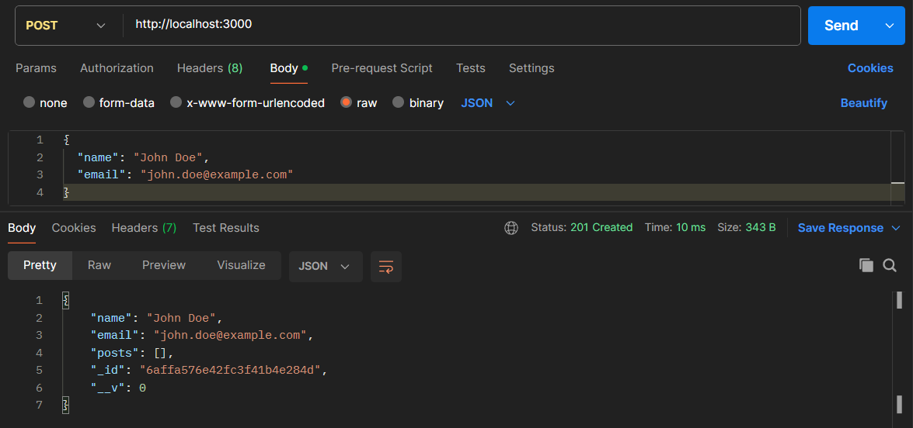

# Feedback Opgave: FaceLink

## npm dependencies
- express
- morgan
- mongoose
- supertest

# Arkitektur (lag og filopsætning)
```
project-root/
├── src/
│   ├── config/          # Konfiguration af MongoDB
│   ├── controllers/     # Håndterer server request og respons baseret på ruten
│   ├── middleware/      # Validering af input
│   ├── models/          # Beskriver brugerens MongoDB-schema og gemmer data
│   ├── repositories/    # Indeholder metoder til at interagere med databasen
│   ├── routes/          # Bestemmer URL og HTTP-metode
│   ├── services/        # Indeholder forretningslogik
│   ├── utils/           # Indeholder hjælpefunktioner, f.eks. til at validere input
│   ├── validators/      # Beskriver brugerens MongoDB-schema og gemmer data
│   └── app.js           # Konfiguration af express app
├── tests/
│   ├── api/             # API test - tester HTTP-endpoints
│   └── model/           # Model test - mongoose-modellen validere et brugerdokument korrekt
├── images/              # Billeder af Postman test til Readme
├── .env/                # Indeholder miljøvariabler, f.eks. MongoDB URI
├── server.js            # Starter server og definerer port
├── package.json         # Project metadata and dependencies
└── README.md            # Project documentation
```

## Mønster MVC (Model-View-Controller)
- Model: kommunikerer med databasen
- Service: indeholder forretningslogik
- Controller: modtager request og sender response

## Hvor mine tests hører til i arkitekturen
```
- Model
- Service
- Controller 
- Routes
- Middleware
- App 
- node:test + supertest
    - Model test - test af modeller skal kun importere modelen og ikke app.js
    - API test - supertest bruges oven i node:test til at sende HTTP-request til app.js
- Server 
- Postman test
    - Test af hele dataflowet fra Postman til MongoDB
    - Test af middleware med forskellige input data
```
- En servicetest undersøger forretningslogikken, mens en API-test undersøger HTTP-request, statuskode og response. Du skal kunne forklare forskellen.

## NPM test værktøjer
De forskellige værktøjer har forskellige formål:
- node:test: Et testframework, der er indbygget i Node.js.
- Supertest: Bruges til at teste HTTP-endpoints i eksempelvis Express.
- Jest: Et testframework. Det er ikke generelt deprecated.
- Joi: Bruges til validering af data, ikke som testframework.
- Axios: Bruges til HTTP-kald, men er ikke et testframework.
- Postman: Bruges til at teste API-endpoints, men er ikke et testframework.
- Vitest: Et testframework, men ikke indbygget i Node.js.

# Delopgave 1 - Oprette en brugerprofil (POST /users)
## Dataflowet fra POST /users til MongoDB
```
HTTP POST /users (endpoint)
↓
app.js: express.json() læser request-body
↓
UserRoutes: matcher POST /users
↓
Validators: UserValidators validerer input data
↓
Middleware: validateCreateUser tjekker om input data er korrekt formateret
↓
UserController: kalder UserService
↓
UserService: håndterer forretningsregler, fx om email allerede findes
↓
UserRepository: læser/skriver brugeren via UserModel
↓
UserModel: beskriver Mongoose-schemaet
↓
MongoDB
```

```
Utils: hjælpefunktioner som lagene kan bruge, fx til at validere input data
```

## Gennemgang af data flow
```
- MongoDB
    - Gemmer data i en database
- UserModel
    - Definerer schema for User objektet
    - Indeholder metoder til at interagere med MongoDB
- UserRepository
    - Indeholder metoder til at interagere med databasen
    - Holder database- og forretningslogik væk fra controlleren
- UserService
    - Indeholder forretningslogikken for brugere
    - Tjekker om email allerede findes
    - Opretter og gemmer den nye bruger gennem User-modellen
    - Holder database- og forretningslogik væk fra controlleren
- UserController
    - Modtager HTTP-requesten
    - Kalder UserService
    - Sender HTTP-response med statuskode og brugerdata
- Middleware
    - Tjekker om input data er korrekt formateret
    - Returnerer fejlbeskeder, hvis data ikke er korrekt formateret
- UserRoutes
    - Definerer endpoint for at oprette en ny bruger
    - Knytter endpoint til User controller og validation middleware
- App
    - Konfigurerer express app med routes og middleware
- Server
    - Starter express server og lytter på en specificeret port
```

## Test disse scenarier
Node.js' indbyggede testværktøj (node:test) og Supertest
- (Model) Kan jeg oprette en bruger med gyldigt navn og email?
- (Model) Bliver en bruger uden email afvist?
- (Model) Kan jeg oprette to brugere med samme email?
- (API) GET /users API test - returnerer alle brugere i databasen

## Oprette en brugerprofil (POST /users)


# Delopgave 2 -  Poste en opdatering (POST /users/{id}/posts)
## Dataflowet fra POST /users/{id}/posts til MongoDB
```
HTTP POST /users/{id}/posts (endpoint)
↓
app.js: express.json() læser request-body
↓
PostRoutes: matcher POST /users/{id}/posts
↓
Middleware
↓
Post routes
↓
Post controller
↓
Post service
↓
Post model
↓
MongoDB
```
## Gennemgang af data flow
```
- Post model
    - Definerer schema for Post objektet
    - Indeholder metoder til at interagere med MongoDB
- Post service
    - Indeholder forretningslogikken for posts
    - Tjekker om userId findes i databasen
    - Opretter og gemmer den nye post gennem Post-modellen
    - Holder database- og forretningslogik væk fra controlleren
- Post controller
    - Håndterer logik for at oprette en ny post
    - Kalder Post service for at håndtere forretningslogik
    - Validerer input og kalder Post model for at gemme data
- Routes
    - Definerer endpoint for at oprette en ny post
    - Knytter endpoint til Post controller og validation middleware
- Middleware
    - Tjekker om input data er korrekt formateret
    - Returnerer fejlbeskeder, hvis data ikke er korrekt formateret
- App
    - Konfigurerer express app med routes og middleware
- Server
    - Starter express server og lytter på en specificeret port
```

## Test disse scenarier

## Poste en opdatering (POST /users/{id}/posts)

